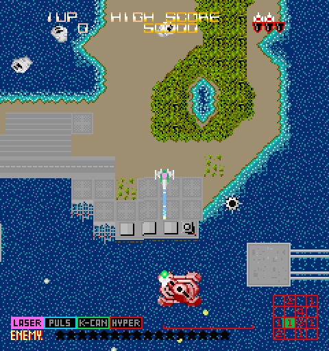
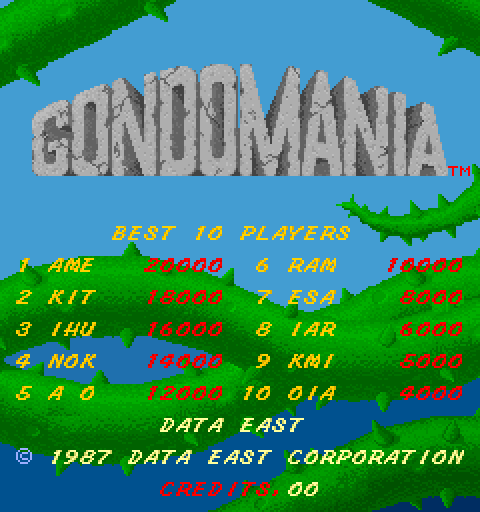
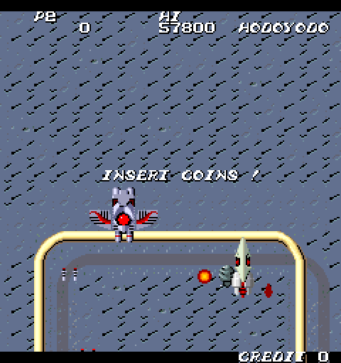

# DEC8 - MiSTer FPGA Core

Three vertical shooters on Data East's 1986-87 8-bit boards, from one RBF:
Last Mission, Gondomania and SRD: Super Real Darwin, ten MAME sets.

  

*Screenshots taken on a MiSTer with this core.*

| Game | Year | Main CPU | MCU | Sound |
|---|---|---|---|---|
| Last Mission (+ US rev 6, US rev 5, Japan) | 1986 | 2x 6809 at 1.5 MHz | i8751 | 6502A, YM2203, YM3526 |
| Gondomania (+ US, Makyou Senshi) | 1987 | HD6309 at 3 MHz (runs 6809 code only) | i8751 | 6502A, YM2203, YM3526 |
| SRD: Super Real Darwin (+ Japan, Japan bootleg) | 1987 | 6809 at 1.5 MHz | i8751 (none on the bootleg) | DECO 222, YM2203, YM3812 |

The sound CPU is the 6502A named in the Last Mission and Gondomania board
documents (MAME emulates an R65C02) and Data East's DECO 222 on SRD.

The CPUs and sound chips use established cores: mc6809i (Greg Miller),
jt8051, jt65c02, jt03 and jtopl (Jose Tejada, jotego); see CREDITS.md. The
video hardware (tilemaps, both sprite chips, palette) is new work.

## Install

### With Update All (recommended)

Add these two lines to `/media/fat/downloader.ini` on your SD card:

```ini
[shmupfan]
db_url = https://raw.githubusercontent.com/shmupfan/Distribution/main/db.json
```

Then run Update All (or `downloader`) from the Scripts menu. It installs the
core and every MRA, including the alternative sets, and keeps them up to
date on later runs. The same entry also brings in other
[shmupfan](https://github.com/shmupfan/Distribution) cores as they are
released.

### Manually

Copy `releases/Arcade-DEC8_*.rbf` to `/media/fat/_Arcade/cores/` and the
MRA files in `releases/` to `/media/fat/_Arcade/`. Alternative sets are in
`releases/_alternatives/` and go to `/media/fat/_Arcade/_alternatives/`.

### ROMs

You need the MAME ROM sets (0.288/0.289 naming) in `/media/fat/games/mame/`:
`lastmisn.zip`, `gondo.zip`, `srdarwin.zip`. Clone sets load from their
parent zip. No ROM data is included in this repository.

Which set to play: the World parents of Last Mission and Gondomania, and the
Japanese SRD, carry MCU programs that MAME marks as bad dumps (Gondomania's
is hand-made from the US one). The US sets of Last Mission (revisions 5 and
6) and Gondomania, Makyou Senshi and the World SRD have verified MCU dumps
and are the accuracy references. The bad-dump sets are offered because they
are the parent sets in MAME.

## Controls

| | Player 1 keys | Player 2 keys | Gamepad (J1) |
|---|---|---|---|
| Move | arrows | R F D G | d-pad |
| Button 1 | Left Ctrl | A | Button 1 |
| Button 2 | Left Alt | S | Button 2 |
| Button 3 (Last Mission) | Space | Q | Button 3 |
| Turn left / right (Gondomania) | Z / X | N / M | Turn Left / Turn Right |
| Start | 1 | 2 | Start |
| Coin | 5 | 6 | Coin |
| Service | 9 | | Service |
| Pause | P | | Pause |

The buttons are named per game in the MAME driver's terms: Last Mission
Shoot, Bomb, Select; Gondomania and SRD Button 1, Button 2.

Gondomania's 12-position rotary joystick works three ways at once, with no
setting to change: the Turn Left / Turn Right buttons or keys (one step per
press, repeating every 100 ms after 250 ms held), a spinner (OSD Spinner
speed: Normal, Fast, Slow), or a paddle (absolute position). Turn Right is
MAME's increment key (X), which lowers the position the game reads, as
MAME's reversed port does.

## OSD options

- DIP switches per set, every switch the MAME driver names, with MAME's
  defaults (see Accuracy notes for the operator manuals).
- Aspect ratio, Orientation (Vertical, Horizontal), Rotate (CCW, the MAME
  direction, or CW for monitors mounted for the other rotation),
  scandoubler effects, HDMI Scale (Normal, V-Integer, Narrower or Wider
  HV-Integer).
- Pause when the OSD is open (on by default).
- Volume: Normal, +6 dB, -6 dB, -12 dB.

Rotate only turns the HDMI picture (the frame buffer). On a CRT the picture
is not rotated: if your monitor is mounted for ROT90 games, set the Flip
Screen DIP switch to On for Gondomania or SRD, as on the original cabinet.
Last Mission has no Flip Screen switch.

The picture is 256 x 240, so the 216-line crop the other shmupfan cores
offer for 224-line games does not apply here.

## Accuracy notes

MAME 0.288 is the reference. Every part of the core was checked against it
in simulation: the video against 12,678 MAME frames (pixel-exact), the full
systems from power-on against MAME's I/O streams, RAM and images, and the
sound board against MAME's register streams and audio. Where MAME and the
hardware are likely to differ, the core follows the most plausible hardware
behaviour and the difference is logged as a research item in docs/PLAN.md.
The main ones:

- **i8751 interrupt timing** follows Intel's documented response (at least
  three machine cycles), where MAME enters the handler at the next
  instruction. Gondomania's random numbers in gameplay and SRD's MCU timing
  differ from MAME because of it (docs/m2_findings.md).
- **Sound CPU timing.** Two cycle-count errors in the vendored jt65c02
  (ADC/SBC one cycle long, untaken branches 2.25 cycles) are fixed to the
  6502 data sheets, which moved SRD's music tempo from 0.33% to 0.014% off
  MAME. An independent second audit confirmed both fixes and the
  unchanged arithmetic (docs/jt65c02_cycle_audit.md), and found the
  remaining differences listed under Known issues.
- **Sound mix (R20).** Measured from a real SRD board: a PCB capture of
  power-on and both demos, lined up with this core's chip outputs over
  100 seconds. On the board the music chip (YM3526 / YM3812) plays at 1.65
  times the effects chip (YM2203 FM); MAME uses 2 times. The core uses
  1.67, and the YM2203's square-wave channels about 3 dB above MAME's
  level, also from the recording. The schematics wire both chips in
  through equal resistors, so the difference is in the chips' own output
  levels. Last Mission and Gondomania use the same chips and the same
  mixing circuit and get the same balance (not yet checked against their
  own recordings). As on the boards, the output is AC coupled (no DC
  offset). Details: docs/r20_pcb_audio_check.md.
- **Mid-screen writes** (palette, tiles, scroll) are drawn as the beam
  meets them; MAME draws each frame at once.
- **Gondomania's main CPU** runs at 3 MHz as in MAME. The board's schematic
  has a jumper for 3 MHz operation; which setting production boards used is
  open (R16).
- **DIP switches**: the Last Mission and Gondomania operator manuals
  (Data East USA) list the same switches as MAME, except three that MAME
  found in the program code and the manuals call unused: Last Mission's
  Invulnerability and Infinite Lives (SW1:7, SW1:8) and Gondomania's Swap
  Buttons (SW1:8). The core offers them as MAME does. The Last Mission
  manual gives the second bonus life setting as 40K/70K and every 90K; the
  program's tables in the World, US revision 6 and US revision 5 sets all
  give 40k, 90k and every 90k, as MAME lists it. No SRD manual was
  available.

## Known issues

- **Gondomania and Last Mission mix.** Set from the SRD board recording
  (same chips and mixing circuit); a direct recording of either board would
  confirm it.
- **Sound CPU cycle counts (R19, R21).** Three groups of instructions
  still differ from the data sheets by one cycle: indexed loads, stores
  and read-modify-write instructions across a page, a taken branch across
  a page (3 cycles, data sheets 4), and JMP (ind) (6 cycles, 5 on the
  NMOS 6502A the boards use). They occur in the sound programs; their
  effect on timing is not measured yet (docs/jt65c02_cycle_audit.md).
- **Last Mission** has no Flip Screen DIP switch, so on a CRT mounted for
  the other rotation it cannot be turned.
- No high-score saving yet. One Last Mission attract frame differs from
  the system simulation in 32 pixels of the text layer (R22).

## Building and verifying

- Simulation: Verilator 5.x and Python 3; the MAME reference captures need
  MAME 0.288 and the ROM sets. `sim/Makefile` lists the M0 to M3 targets,
  `sim/m4.mk` the board-level ones (MRA generation and check, the board
  run against the M2 reference, lint).
- Synthesis: Quartus 17 project at the repository root.

## License and credits

GPL-3.0-or-later for the combined work. Vendored components keep their own
licences and headers. See `LICENSE` and `CREDITS.md`. The core relies on
MAME's DEC8 driver by Bryan McPhail and Stephane Humbert.

Development used Anthropic's Claude as a coding tool.
